# Help Desk Home Lab: Windows Server, Active Directory & Ticketing

A small corporate IT environment I built from scratch and then ran like a real help desk: working support tickets end to end, troubleshooting real problems, and documenting every fix.

**Built with:** Windows Server 2025 · Active Directory · DNS · DHCP · Group Policy · NTFS permissions · Windows 11 Enterprise · PowerShell · Jira Service Management · VirtualBox

---

## Contents
- [Lab overview](#lab-overview)
- [What I built](#what-i-built)
- [Support tickets](#support-tickets)
- [Troubleshooting highlights](#troubleshooting-highlights)
- [PowerShell automation](#powershell-automation)
- [What I learned](#what-i-learned)

---

## Lab overview

```
                 Internet
                    │
          VirtualBox NAT Network (10.0.2.0/24)
          Gateway 10.0.2.1 · VirtualBox DHCP disabled
          ┌─────────┴──────────┐
          │                    │
   ┌──────┴──────┐      ┌──────┴──────┐
   │    DC01     │      │    WS01     │
   │ Server 2025 │      │ Windows 11  │
   │ 10.0.2.10   │      │ Enterprise  │
   │ (static)    │      │ 10.0.2.100  │
   │             │      │ (via DHCP)  │
   │ AD DS · DNS │      │ Joined to   │
   │ DHCP · Files│      │ corp.local  │
   └─────────────┘      └─────────────┘
```

| Component | Configuration |
|---|---|
| Domain | `corp.local` (NetBIOS: `CORP`) |
| Domain controller | DC01, Windows Server 2025, static IP 10.0.2.10 |
| Roles | AD DS, DNS, DHCP, File Server |
| DHCP scope | 10.0.2.100 – 10.0.2.200, gateway 10.0.2.1, DNS 10.0.2.10 |
| Client | WS01, Windows 11 Enterprise, domain-joined |
| Ticketing | Jira Service Management (free plan) |

---

## What I built

### 1. Domain controller and Active Directory
Installed Windows Server 2025 (Desktop Experience), set a static IP, and promoted the server to a domain controller for a new forest, `corp.local`.

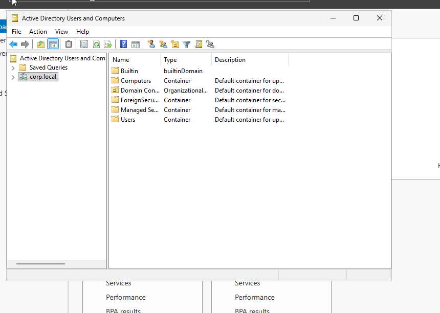

### 2. OU structure, users, and security groups
Created a `Corp` OU with one OU per department and a `Groups` OU. Permissions are granted to security groups (`SG-Sales`, `SG-HR`, `SG-Finance`, `SG-IT`), never to individual users.

```
corp.local
 ├── Corp
 │    ├── Finance
 │    ├── Groups      (SG-Sales, SG-HR, SG-Finance, SG-IT)
 │    ├── HR
 │    ├── IT
 │    ├── Sales
 │    └── Workstations
 └── Disabled Users   (offboarded accounts, outside Corp so no employee GPOs apply)
```

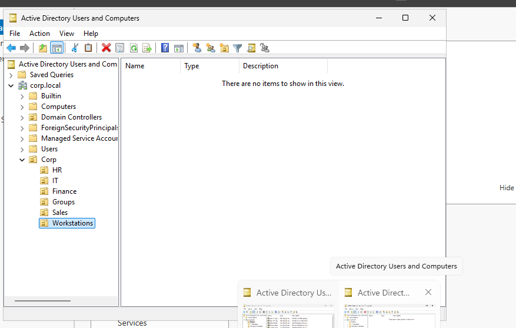

### 3. DHCP
Disabled VirtualBox's built-in DHCP so DC01 hands out addresses, like in a real office. The scope options give clients the gateway, the DNS server (DC01), and the domain name.

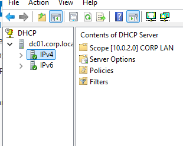

### 4. Windows 11 client joined to the domain
WS01 received its address, gateway, and DNS from DC01, then joined `corp.local`.

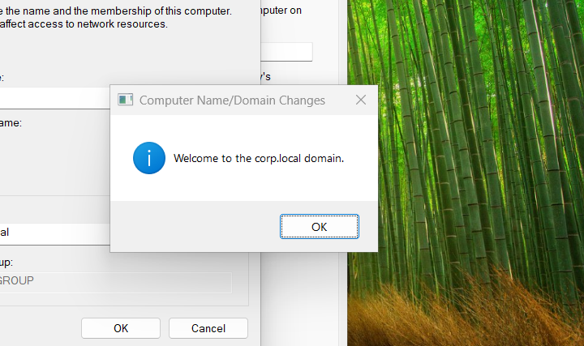

### 5. Department file shares
Each department has a share on DC01. Share permissions are open to Authenticated Users; NTFS permissions do the real restriction (inheritance disabled, `Domain Users` removed, department group given **Modify**). I tested both directions: users can open their own share and are denied on others (least privilege).

### 6. Group Policy
| GPO | Linked to | Purpose |
|---|---|---|
| Map Department Drives | Corp OU | Maps S:, H:, F:, I: with **item-level targeting** so each user only gets their department's drive |
| Default Domain Policy | Domain | Account lockout after 5 failed attempts (10 min) |
| Workstation Logon Settings | Workstations OU | "Always wait for the network at startup and logon" (root-cause fix, see IT-8) |

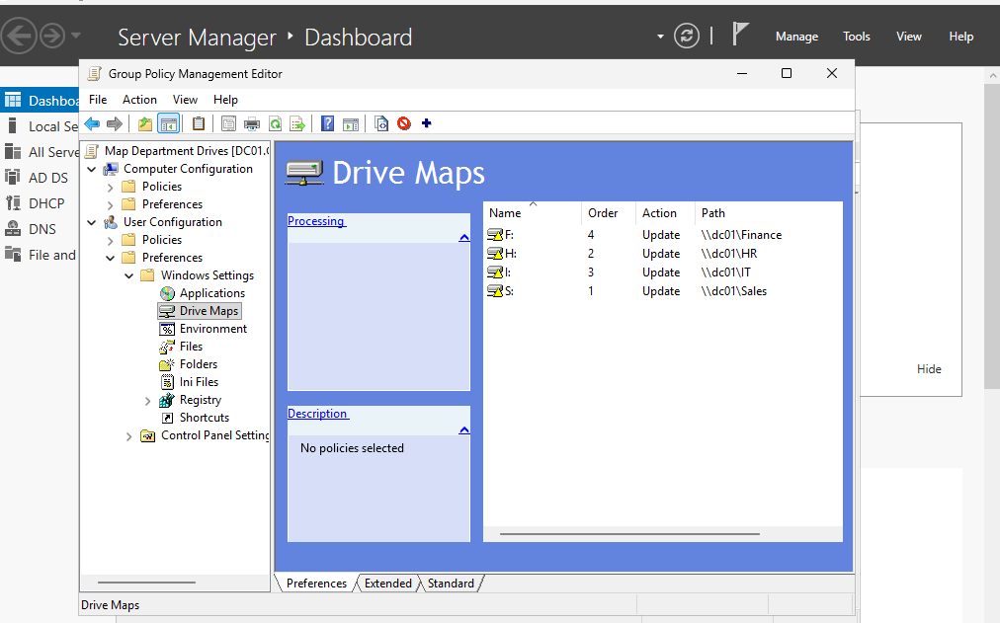

| Sales user sees only S: | HR user sees only H: |
|---|---|
| 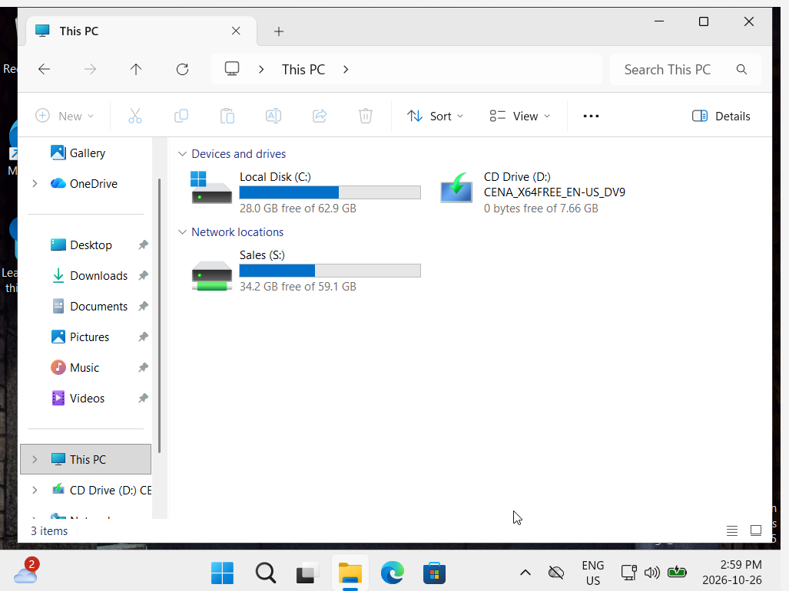 | 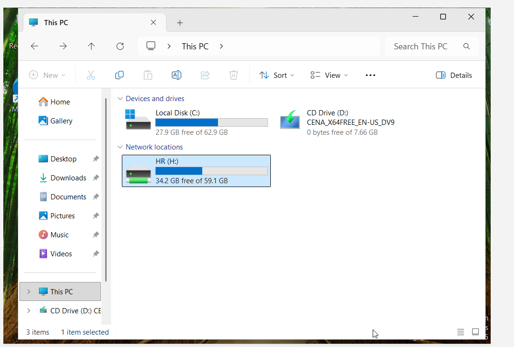 |

---

## Support tickets

I set up **Jira Service Management** and worked each scenario as a ticket: assign → investigate → fix → verify → document. Every ticket has a technical **internal note** for other techs and a plain-language **reply** to the user.

| Ticket | Type | Summary | Key skills |
|---|---|---|---|
| IT-1 | Incident | Account locked out | Lockout policy, unlocking in ADUC |
| IT-2 | Incident | Domain logins and Group Policy failing | Time skew breaking Kerberos, NTP configuration |
| IT-3 | Request | Forgotten password | Reset with forced change at next logon |
| IT-4 | Request | New hire onboarding | Account, OU, attributes, manager, group, testing |
| IT-5 | Request | Employee offboarding | Disable, remove groups, move OU, cached logon finding |
| IT-6 | Request | Access to another department's share | Group membership, access tokens, approval, temporary access |
| IT-7 | Request | Remove temporary access *(open, scheduled)* | Preventing privilege creep |
| IT-8 | Problem | Changes not applied at first sign-in | Root cause across IT-5 and IT-6, fixed with GPO |
| IT-9 | Incident | "No internet" | DHCP outage, APIPA (169.254), escalation |
| IT-10 | Incident | Internet works, drives don't | DNS misconfiguration on the client |
| IT-11 | Request | Bulk onboarding of 7 new hires | PowerShell automation |

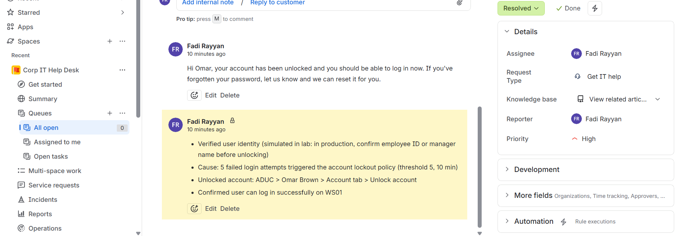

---

## Troubleshooting highlights

### IT-2: Time skew broke every domain login
**Symptom:** `gpupdate /force` failed with "could not resolve the computer name" and "LDAP Bind function call failed." Domain logins failed on WS01, even for the domain admin.

**Investigation:** Both clocks were wrong. DC01 was about 23 hours behind real time, because the VMs had been resumed from saved states.

**Root cause:** Kerberos rejects authentication when clocks differ by more than 5 minutes.

**Fix:** Configured DC01 as the authoritative time source:
```powershell
w32tm /config /manualpeerlist:"time.windows.com,0x8" /syncfromflags:manual /reliable:yes /update
Restart-Service w32time
w32tm /resync /force
```
Cold-booted WS01 so it synced from DC01, then confirmed Group Policy applied. Installed VirtualBox Guest Additions to prevent it from recurring.

| Error | Cause |
|---|---|
| 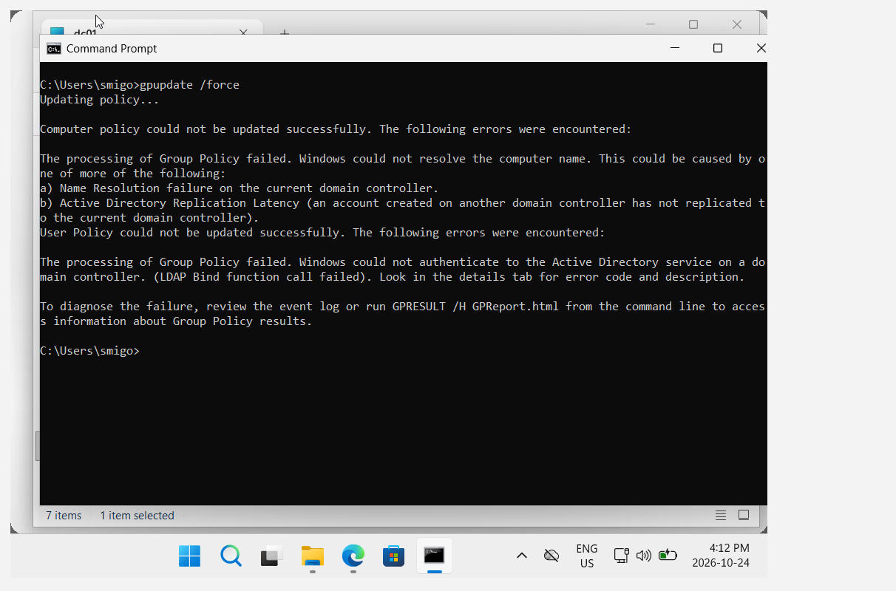 | 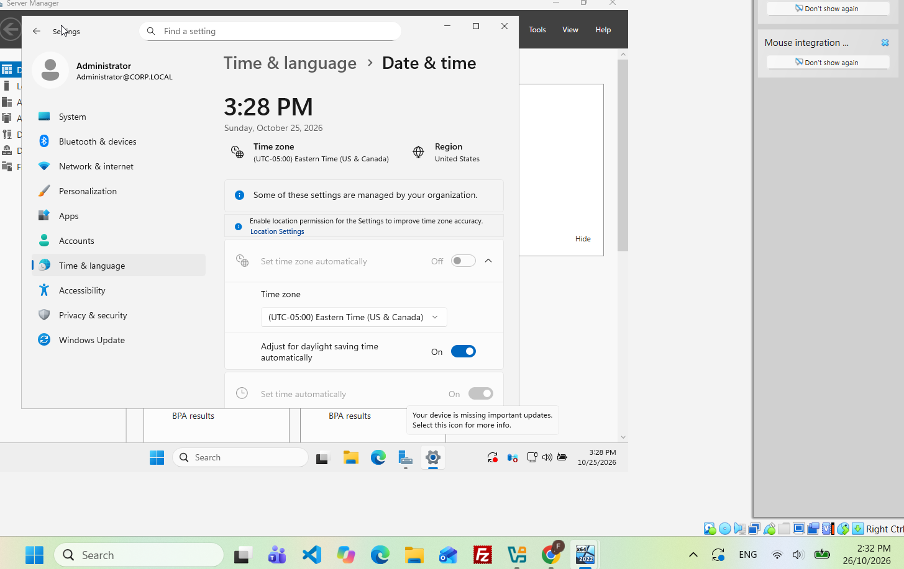 |

### IT-5: A disabled user could still reach the desktop
After disabling an account, the user could still sign in to WS01. I investigated instead of assuming:

- `Get-ADUser mdover` → `Enabled: False` (AD was correct)
- `klist` → **0 Kerberos tickets**, so the login came from **cached credentials**, not the domain controller
- `dir \\dc01\Sales` → *"account is currently disabled"*, so **company data stayed protected**
- After a clean sign-out, the login was blocked

**Recommendation recorded in the ticket:** offboarding should also include a password reset, signing out active sessions, and collecting the device.

| Cached login: no Kerberos tickets | Network access blocked |
|---|---|
| 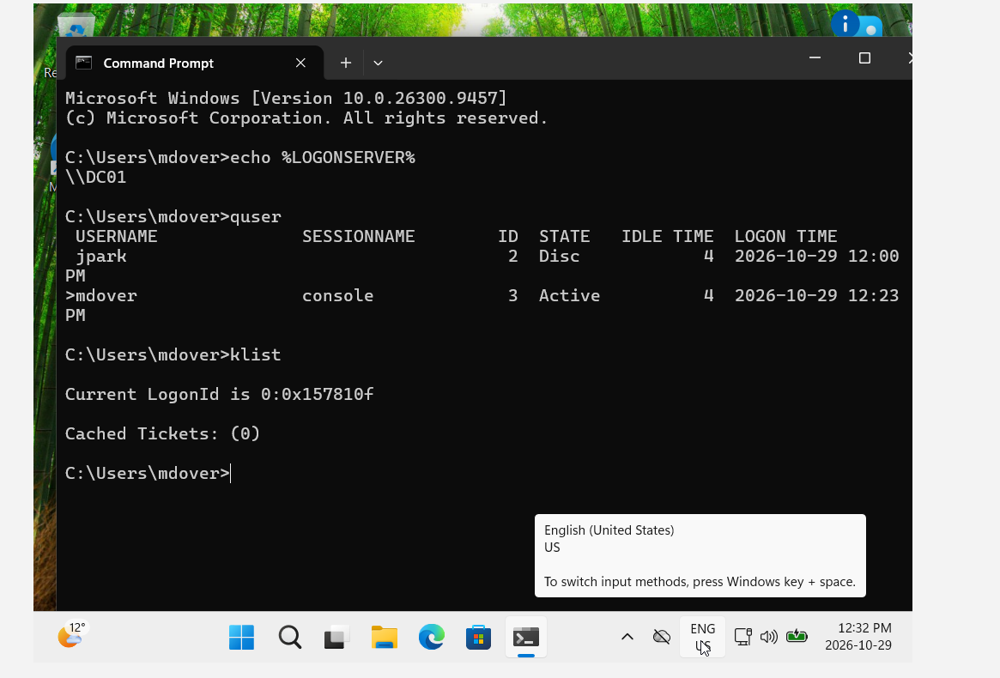 | 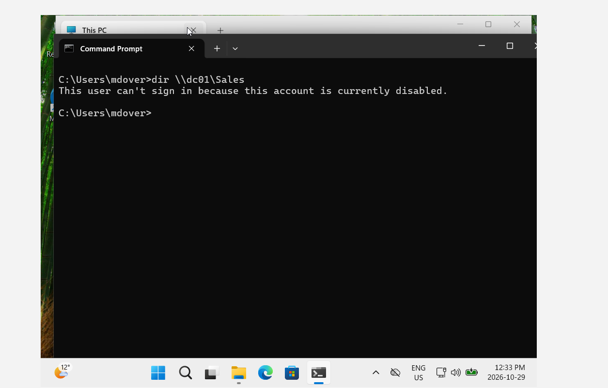 |

### IT-6 → IT-8: From two incidents to one root cause
In IT-6, a user added to `SG-Finance` was still denied. Her access token is built at logon, so a sign-out was needed. Even after one sign-out, `whoami /groups` still didn't show the new group; it only appeared after a **second** sign-in.

I connected this to IT-5: both were caused by **Windows Fast Logon Optimization**, which signs users in with cached credentials and group info before contacting the domain controller.

**Fix (IT-8, problem management):** a GPO on the Workstations OU enabling *"Always wait for the network at computer startup and logon."* Verified with `gpresult`, then tested by adding a user to a new group: it applied at the **first** sign-in.

**Trade-off noted:** sign-in may be slightly slower because workstations wait for the network.

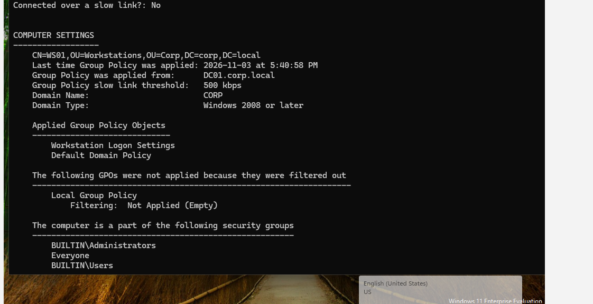

### IT-9: "No internet" was really a DHCP outage
| Clue | Meaning |
|---|---|
| IPv4 `169.254.192.181`, mask `255.255.0.0`, no gateway | **APIPA**: the PC couldn't reach a DHCP server |
| `ping` to the server and the internet: "General failure" | No route without a valid IP and gateway |
| `Get-Service DHCPServer` → **Stopped** | Root cause on the server |

Once I realized the outage affected **every client**, not just one user, I **escalated the priority** to Highest. Fixed with `Start-Service DHCPServer`, confirmed it was set to start automatically, and verified the client got `10.0.2.100` back.

| APIPA address | Root cause |
|---|---|
| 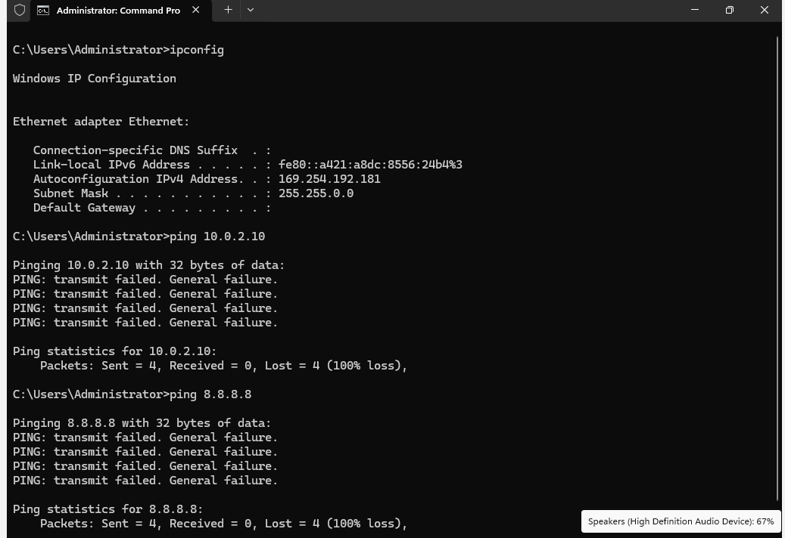 | 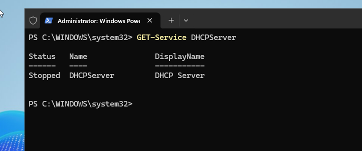 |

### IT-10: The IP works, but the name doesn't
| Test | Result |
|---|---|
| `ping 10.0.2.10` | Network fine |
| `ping dc01.corp.local` | Could not find host |
| `ping google.com` | Public DNS works |
| `nslookup dc01.corp.local` | Asked **dns.google (8.8.8.8)**: non-existent domain |
| `nltest /dsgetdc:corp.local /force` | ERROR_NO_SUCH_DOMAIN |

**Root cause:** the DNS server had been set manually to `8.8.8.8`, overriding the DNS from DHCP. Public DNS doesn't know about the private `corp.local` domain. A short-name fallback (LLMNR/NetBIOS) still opened `\\dc01\Sales`, which masked the problem, while Group Policy failed.

**Fix:** set DNS back to automatic, flushed and re-registered DNS, and verified with `nslookup`, `nltest`, and `gpupdate`.

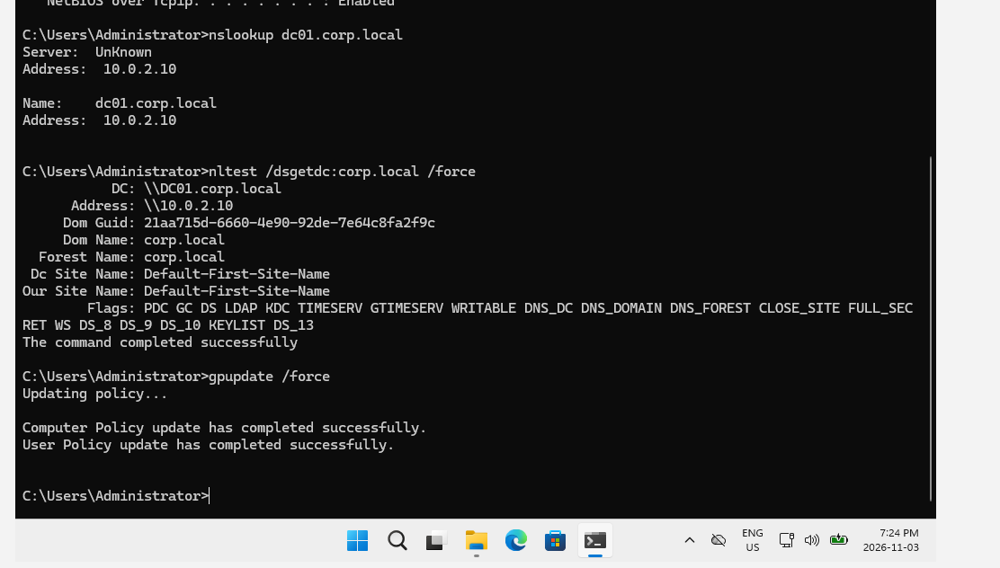

---

## PowerShell automation

[`scripts/New-BulkUsers.ps1`](scripts/New-BulkUsers.ps1) onboards new hires in bulk from a CSV ([`scripts/new_hires.csv`](scripts/new_hires.csv)). For each row it:

- builds the logon name (first initial + last name)
- **skips duplicates** (the script is safe to run twice)
- checks that the department OU and security group exist
- creates the account in the right OU with title, department, and company
- sets a temporary password with **change at next logon** (the password is prompted for, never stored in the file)
- adds the user to their department group, so Group Policy maps their drive automatically
- logs every result to the screen and to a log file

It supports **`-WhatIf`** for a dry run before making changes.

```powershell
# Test run: shows what would happen, changes nothing
.\New-BulkUsers.ps1 -CsvPath .\new_hires.csv -WhatIf

# Live run
.\New-BulkUsers.ps1 -CsvPath .\new_hires.csv
```

The sample CSV includes two deliberate error cases: an existing user (skipped) and a department that doesn't exist (reported, and the script keeps going).

**Result:** Created 5 · Skipped 1 · Failed 1, verified with `Get-ADUser` and `Get-ADGroupMember`, and confirmed by signing in as a new hire.

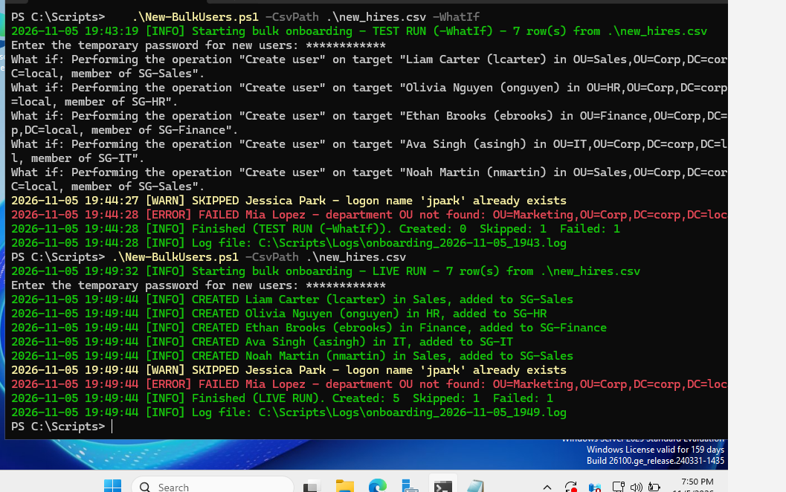

---

## What I learned

- **Check the basics first.** `ipconfig` and a couple of pings told me whether a problem was DHCP, DNS, or something else.
- **Error messages point to a symptom, not a cause.** The same "could not resolve the computer name" error came from time skew in IT-2 and from DNS in IT-10.
- **Caching hides problems.** Cached logons, cached DC lookups, and access tokens built at logon all caused "it should work but doesn't" moments.
- **Test that access is blocked, not just that it works.** Least privilege only counts if it's verified.
- **Fix the root cause.** Instead of telling users to "sign in twice," I found the cause behind two tickets and fixed it with Group Policy.
- **Document for two audiences:** technical notes for the next tech, plain language for the user.

---

## Screenshots

Every screenshot is in [`screenshots/`](screenshots), organized by phase and by ticket.

*Lab note: all users and data are fictional. Some ticket scenarios, such as the DHCP outage and the DNS change, were simulated on purpose so I could troubleshoot them.*
